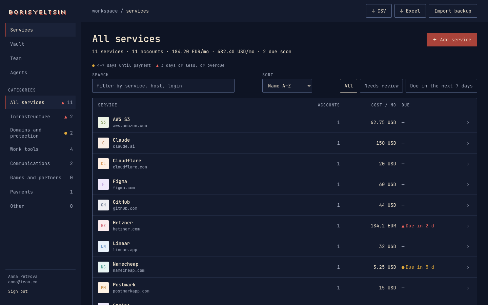
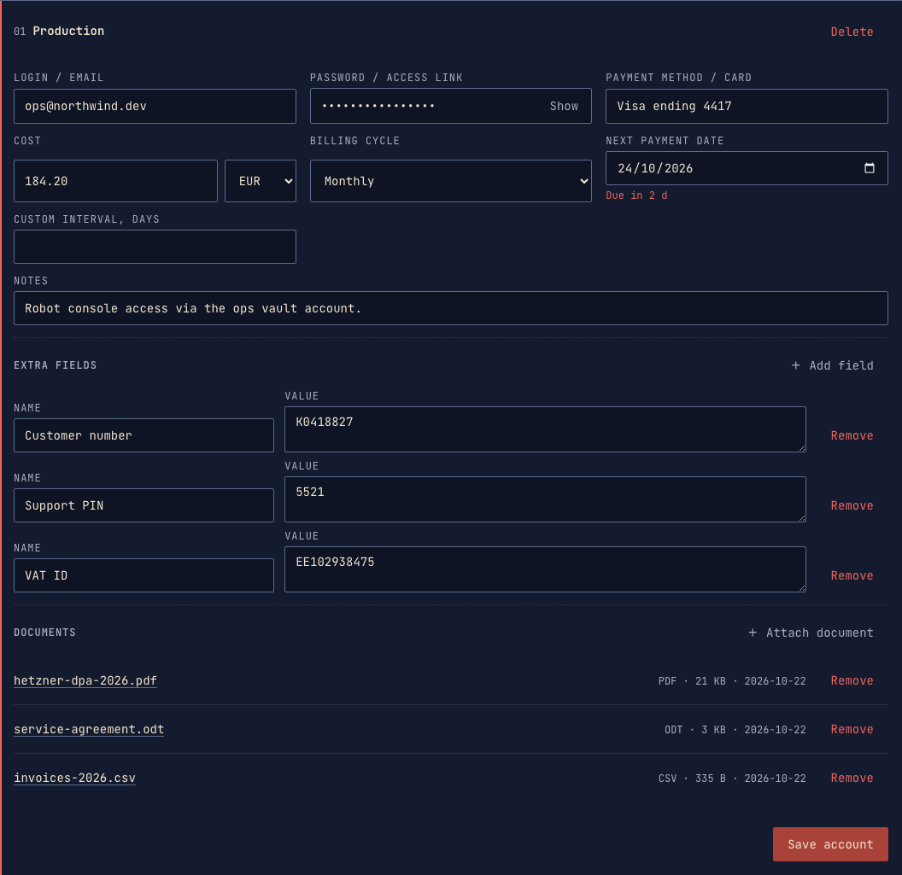
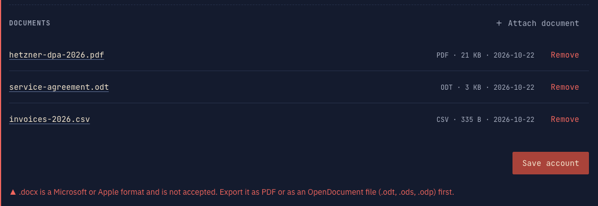
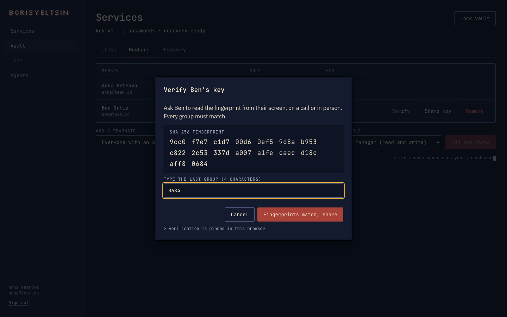
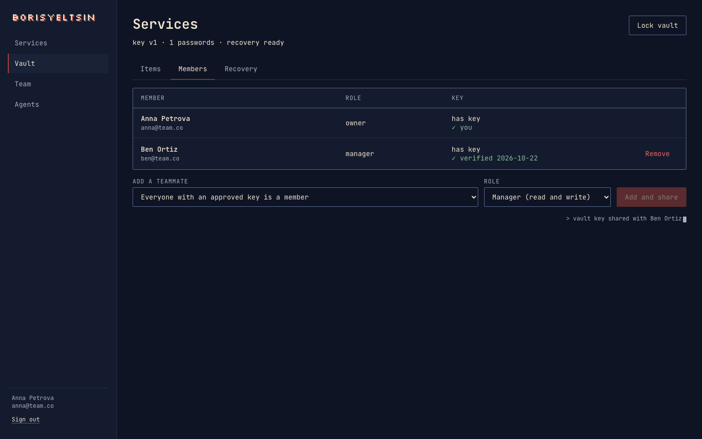
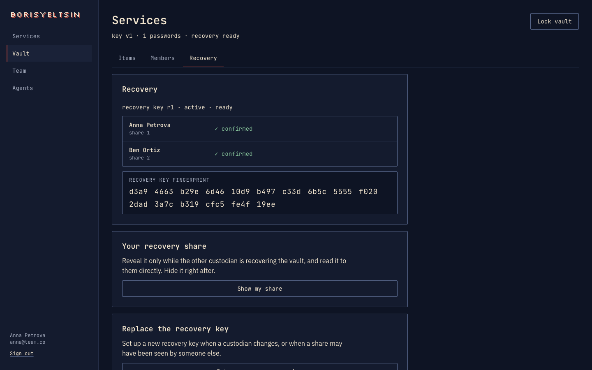
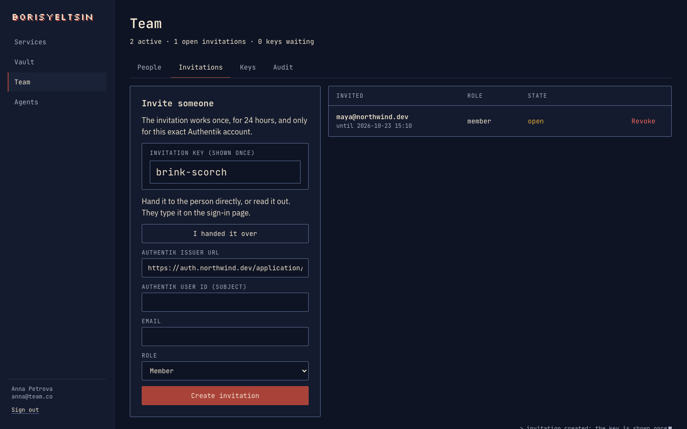
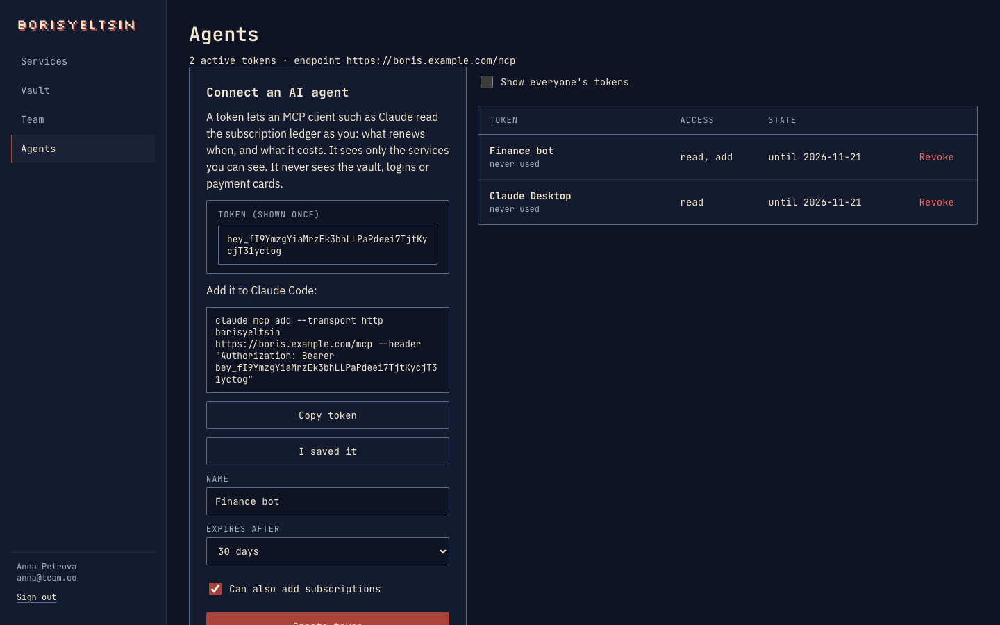
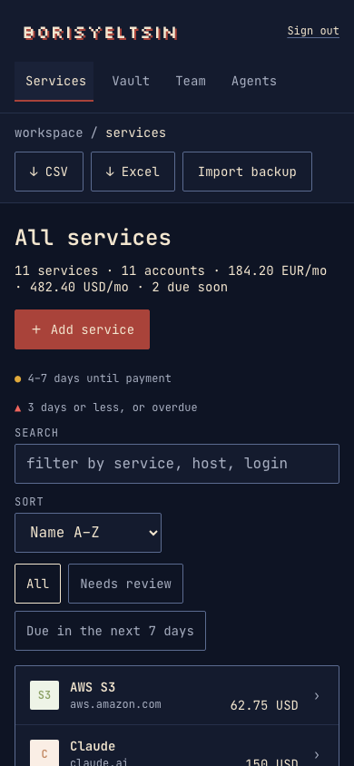

**Every subscription your team pays for, and the logins behind them, in one self-hosted place.** BorisYeltsin tracks what renews when and what it costs, and keeps passwords, account details and contracts in a vault the server cannot read.

## Features

### Know what you pay and what renews next



- Services grouped by category, each with one or more accounts and a subscription: monthly, quarterly, annual or a custom interval, in any currency.
- Monthly spend per currency at the top. Renewals in the next 7 days are marked, and alerts go out at 7, 3 and 1 days.
- Auto-renewing subscriptions roll forward to their next date by themselves.
- Search by service, host or login. Sort by name or by date added.
- Export to CSV or Excel. Import a JSON backup.

### Keep the whole account in one card



Each account holds its login, password, payment card label, billing and notes. Add your own **extra fields** for anything else: customer number, support PIN, VAT ID, recovery codes. Attach **documents** such as contracts, DPAs and invoices.

The password, the extra fields and the documents are encrypted in your browser before they are sent. The server stores ciphertext; it never sees the contents or even the file names.

### Open formats only



Documents must be PDF, OpenDocument (`.odt`, `.ods`, `.odp`, `.odg`), an image (PNG, JPEG, WebP, GIF) or plain text (`.txt`, `.md`, `.csv`, `.json`, `.yaml`, `.xml`, `.pem` and similar). Word, Excel, PowerPoint, RTF, Pages, Numbers, Keynote and HEIC files are refused, and a file whose contents do not match its extension is refused too. Up to 10 MB per file and 20 per account.

### Share only with keys you checked



Every person has their own key pair, unlocked by a passphrase only they know. To share the vault you compare your teammate's key fingerprint with them on a call or in person; the vault key is then sealed to that key alone. Members can read, managers can also edit, owners can also share and rotate the key.



### Recover without a back door



Each person gets a personal recovery key when they enroll. On top of that, two custodians each hold half of an organization recovery key: together they can restore the vault when every key holder is gone, and neither can do it alone. New passwords cannot be saved until recovery is set up. See [docs/RECOVERY.md](docs/RECOVERY.md).

### Invite people with two words



Sign-in goes through your own Authentik with MFA; there are no local passwords and no public sign-up. An invitation is a two-word key you can read out loud. It works once, for 24 hours, and only for the one Authentik account it was made for. Roles are admin, manager, member and read-only; keys need an admin's approval, and every change lands in the audit log.

### Ask your AI agent



An MCP endpoint lets Claude and other agents answer "what is our monthly bill?" or "what renews next week?", and add a subscription when you tell them to. Tokens are personal, expire in 7 to 90 days, and see only the services their owner can see. Agents never reach the vault, logins or cards. See [docs/AGENT_INTEGRATION.md](docs/AGENT_INTEGRATION.md).

### Works on a phone



## Release

**Latest: [v0.4.0](https://github.com/nostalpixel/borisyeltsin/tree/v0.4.0)**, early access. Image: `ghcr.io/nostalpixel/borisyeltsin:0.4.0` (`linux/amd64`, `linux/arm64`).

| Version | Changes | Upgrade notes |
|---|---|---|
| 0.4.0 | Accounts get **extra fields** (account ID, support PIN, contract number) and **documents** (contracts, invoices, keys), both encrypted with the password. Documents: PDF, OpenDocument, images or plain text, up to 10 MB; Microsoft and Apple formats are refused. Services list sorts by name or date added. Invitation keys are two words (`eggs-watermelon`). Saving an account without a cost or date no longer creates a 0.00 subscription due today. | Migration 005 adds a table. Backups grow with attached documents (up to 1 GB per vault). Open invitations from 0.3.0 keep working. |
| 0.3.0 | AI agents: an MCP endpoint answers what renews when and what it costs, and adds subscriptions with a write token. New **Agents** page for personal tokens ([docs/MCP.md](docs/MCP.md), [docs/AGENT_INTEGRATION.md](docs/AGENT_INTEGRATION.md)). Amounts above one trillion are refused. | Migration 004 adds a table. No other steps. |
| 0.2.1 | Auto-renewing subscriptions move to their next renewal date instead of showing overdue forever. | No migration. |
| 0.2.0 | Organization recovery: two custodians and a recovery key can restore vault access ([docs/RECOVERY.md](docs/RECOVERY.md)). | Migration 003 is one-way. Take a `pg_dump` first. Recovery set up on 0.1.0 is removed: set it up again (new passwords are blocked until then). |
| 0.1.0 | First published image: ledger, shared vault, Authentik sign-in. | |

Early access means: one vault per organization, one server process, and no independent review of the encryption yet. Agent tokens skip the Authentik MFA check by design; they read the ledger only and never the vault. Some ledger screens are missing (payment history, payment methods, auto-renew toggle, spend totals). See [TODOS.md](TODOS.md). Set up recovery on day one: a member who loses their passphrase with no recovery in place loses vault access.

## How it runs

Subscription ledger and team credential vault for a small organization. One Go process serves the API, the renewal scheduler, and the compiled React application. Postgres stores the ledger in the clear and the vault as ciphertext. People sign in with an external Authentik. There is no local password and no public registration.

Repository: [github.com/nostalpixel/borisyeltsin](https://github.com/nostalpixel/borisyeltsin). License: MIT.

## Run

```bash
cp .env.example .env
# Set POSTGRES_PASSWORD and the OIDC variables. See below.
docker compose up -d
```

`docker compose up` fails until `POSTGRES_PASSWORD` is set. Compose starts `postgres` (no published port) and `boriseltsyn` on port 8080. The image build runs the web build, then a static Go binary, and runs as uid 10001. Migrations run on startup.

`/healthz` reports that the process is listening. `/readyz` pings Postgres. The image health check uses `/readyz`.

The database URL inside Compose uses `sslmode=disable` on the Docker network. Put TLS on the reverse proxy in front of port 8080. `COOKIE_SECURE` defaults to `true`, so the session cookie only travels over HTTPS. Set it to `false` only to try the app over plain `http://localhost`. Leave `TRUST_PROXY` false unless that proxy sets `X-Forwarded-For` and you want it used as the rate-limit key.

### Release images

Tagged releases are published as `ghcr.io/nostalpixel/borisyeltsin` for `linux/amd64` and `linux/arm64`. Set `BORISELTSYN_VERSION` to a release version (for example `0.4.0`) and pull instead of building:

```bash
docker compose pull boriseltsyn
docker compose up -d --no-build
```

The default `BORISELTSYN_VERSION` is `dev`, which is never published, so a plain `docker compose up` builds the image from this checkout. Before upgrading to a release that contains a migration, take a `pg_dump` (see [docs/BACKUP.md](docs/BACKUP.md)).

Pushing a tag `vX.Y.Z` runs the whole CI and then publishes the image. The release fails without pushing if Trivy finds a fixable HIGH or CRITICAL vulnerability. CI also runs `npm audit` on shipped dependencies, starts the Compose stack, checks `/readyz` and the security headers, creates a bootstrap invite, and runs the restore drill. Dependabot opens weekly update PRs for Go, npm, Docker base images and Actions.

Secrets may be passed as `NAME_FILE` paths, for example `OIDC_CLIENT_SECRET_FILE=/run/secrets/oidc_client_secret`. A readable file replaces the plain environment variable. This includes `DATABASE_URL_FILE`.

### Authentik

Create a confidential OIDC client. Redirect URL: `${PUBLIC_URL}/api/v1/auth/callback`. Scopes: `openid`, `profile`, `email`. The authorization server must put an MFA method in the `amr` claim. The default allow-list is `mfa`, `otp`, `totp`, `webauthn`. A token without one of those values does not create a usable session.

Set `OIDC_ISSUER`, `OIDC_CLIENT_ID`, and `OIDC_CLIENT_SECRET`. With an empty issuer the process still starts and login returns 503.

### First administrator

While the database has zero users, set all four bootstrap variables:

- `BOOTSTRAP_ORG_NAME`
- `BOOTSTRAP_OIDC_ISSUER` (same issuer the person will log in with)
- `BOOTSTRAP_OIDC_SUBJECT` (the Authentik subject)
- `BOOTSTRAP_EMAIL`

Then create the invite from the running container:

```bash
docker compose exec boriseltsyn boriseltsyn bootstrap-invite
```

It prints `BOOTSTRAP_INVITE_TOKEN=` (two words, such as `eggs-watermelon`) to that terminal only; the server log never contains it. The database stores only a SHA-256 of the key. The token lasts 24 hours and works once. Running the command again revokes the earlier token and prints a new one. Once the first person has signed in, the command refuses to run.

Paste the token on the login page. The browser stores it in an HttpOnly cookie and sends the person to Authentik. After MFA, the browser generates an X25519 key, asks for a passphrase of at least 12 characters, and shows a personal recovery key once. The sole user may approve their own key. Every later key needs a different active admin.

New vault passwords cannot be saved until organization recovery is set up: an admin picks two custodians with approved keys, both confirm their shares, and a vault owner seals the vault key to the recovery key. The ledger works before that.

Read [docs/RECOVERY.md](docs/RECOVERY.md) before storing a real password. If the passphrase, the personal recovery key, and both organization shares are lost, the vault cannot be opened.

### AI agents (MCP)

`/mcp` is a Model Context Protocol endpoint for agents such as Claude. Tools: `monthly_bill`, `upcoming_renewals`, `list_subscriptions` and, for write tokens, `add_subscription`. It never reaches the vault, logins or payment cards.

1. Open **Agents** in the app and create a token (7, 30 or 90 days; tick **Can also add subscriptions** to allow writes). It is shown once.
2. Connect your client:

```bash
claude mcp add --transport http borisyeltsin https://boris.example.com/mcp \
  --header "Authorization: Bearer $BORISYELTSIN_TOKEN"
```

A token acts as the person who created it and sees only what they can see. Revoke it on the same page. Point your agent at [docs/AGENT_INTEGRATION.md](docs/AGENT_INTEGRATION.md): it lists the tools, arguments, rules (confirm before adding) and errors. [docs/MCP.md](docs/MCP.md) covers permissions, limits and risk.

## Develop

```bash
go test ./...
cd web && npm test && npm run build
POSTGRES_PASSWORD=ci docker compose config
```

Integration tests start `postgres:16-alpine` and skip when Docker is missing. `make ui` copies a local Vite build into the embed directory for `go run`. Do not commit that copy. The image build copies the UI itself.

Generated sqlc code is committed. Regenerate with sqlc 1.30.0 and keep the diff empty.

## Documents

- [docs/IMPLEMENTATION_PLAN.md](docs/IMPLEMENTATION_PLAN.md) — agent work order
- [docs/CRYPTO.md](docs/CRYPTO.md) — constructions, additional data, and what the server cannot prove
- [docs/THREAT_MODEL.md](docs/THREAT_MODEL.md) — mitigations and the claims this project does not make
- [docs/RECOVERY.md](docs/RECOVERY.md) — personal key, two custodians, departure, and permanent loss
- [docs/BACKUP.md](docs/BACKUP.md) — `pg_dump` and the secret-free export
- [docs/MCP.md](docs/MCP.md) — AI agent endpoint, tokens, tools and what they can reach
- [docs/AGENT_INTEGRATION.md](docs/AGENT_INTEGRATION.md) — agent-readable integration guide: connection, tool schemas, rules, examples, errors
- [SECURITY.md](SECURITY.md) — reporting and the short limit list
- [DESIGN.md](DESIGN.md) — theme tokens, type, retro budget, layout and accessibility rules

## Stack

React, TypeScript, Vite, Tailwind. Client crypto: `libsodium-wrappers-sumo`. Go, chi, pgx, sqlc. PostgreSQL 16. Authentik OIDC with PKCE. Docker Compose. No Redis, Kubernetes, or second application process.
